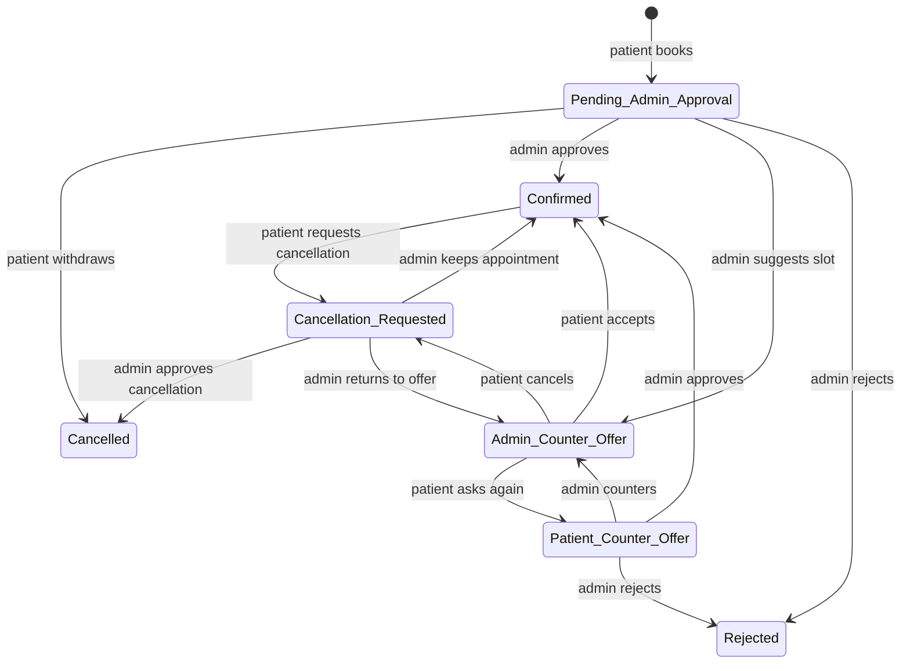
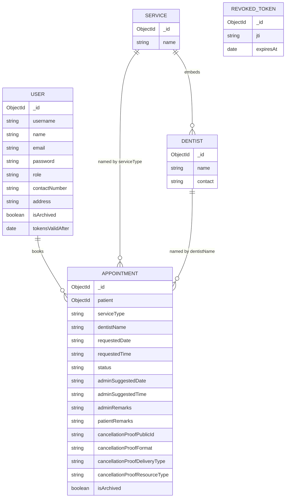

# DentaLink

DentaLink is a full-stack dental clinic appointment system for patients and clinic administrators. Patients can register, complete OTP-based login, manage their profile, book an available dentist, respond to counter-offers, request cancellations, and optionally attach cancellation proof. Administrators can manage appointment workflows, users, services, dentists, archives, and permanent deletion rules.

## Current verification status

Verified on **October 14, 2026**:

- Server automated tests: **32 passed, 1 skipped** in the normal suite; **33 passed** when the opt-in real Cloudinary round trip is enabled with `RUN_CLOUDINARY=1`.
- Client unit tests: **4 passed**.
- Client production build: **passes**.
- Client lint: **0 errors, 8 warnings**. The warnings are the consciously downgraded `react-hooks/set-state-in-effect` rule for initial data-loading and page-reset effects.
- `npm audit`: **0 vulnerabilities** in both projects.
- Read-only database health check: **all checks pass** after removing one obsolete development appointment whose service no longer existed.
- Real email and Cloudinary smoke tests pass. Manual browser click-through remains pending.

## Features

### Patients

- Public registration; public users cannot choose an admin role.
- Password login followed by a six-digit email OTP.
- Forgot-password flow with a separate OTP purpose.
- Profile editing, password changes, and typed-confirmation account deletion.
- Service and dentist selection with clinic time slots from 08:00 to 18:00.
- Appointment booking, counter-offer acceptance, alternative-time requests, and cancellation requests.
- Optional JPG, PNG, or PDF cancellation proof up to 5 MB.
- User-visible server and network errors, including slot conflicts.

### Administrators

- Appointment approval, rejection, counter-offer, cancellation approval, and cancellation denial.
- User creation and role assignment.
- Service creation/rename/deletion and dentist assignment.
- Archive, restore, and permanent-delete workflows.
- Typed `DELETE` confirmation before permanent deletion.
- Guards against self-archive/self-delete and removal of the final active admin.
- Search and pagination UI; the API also supports opt-in server-side pagination.

### Security and integrity

- Passwords hashed with bcrypt using the shared configured cost.
- JWTs pinned to HS256, assigned a unique `jti`, and revocable on logout.
- Browser JWTs are held in httpOnly cookies; state-changing requests use double-submit CSRF protection.
- Tokens issued before a password change/reset are rejected.
- Archived/deleted/password-invalidated sessions force the client to log out.
- OTPs are hashed, expire after 10 minutes, are single-purpose, and burn after five incorrect attempts.
- OTP issuance is capped per account over a rolling 24-hour window.
- Accounts lock for 15 minutes after five incorrect passwords.
- Administrators can clear a verified user's login lock; the action is audited.
- API-wide and authentication-specific rate limiting.
- Helmet security headers, response compression, CORS allow-listing, and JSON size limits.
- Express Validator rules reject invalid fields and NoSQL operator objects.
- Database unique indexes guard confirmed dentist slots, one unresolved admin-waiting request per patient, and case-insensitive usernames.
- Uploaded files are type-checked by content before Cloudinary storage.
- Cancellation proofs use authenticated Cloudinary assets and 60-second signed URLs.
- Privileged changes are recorded in a queryable audit log.
- Requests emit structured JSON completion/error logs with request IDs.

## Tech stack

| Area | Technologies |
| --- | --- |
| Client | React 19, Vite 8, React Router 7, Axios, Bootstrap 5 |
| Server | Node.js, Express 5, CommonJS |
| Database | MongoDB, Mongoose 9 |
| Authentication | JSON Web Tokens, bcrypt, email OTP |
| Email | Nodemailer |
| Uploads | Multer, Cloudinary |
| Validation/security | express-validator, Helmet, express-rate-limit, CORS |
| Tests | Node.js built-in test runner, integration test database |

## Repository layout

```text
DentaLink/
├── client/                    React/Vite single-page application
│   ├── src/api/               Axios client and shared error conversion
│   ├── src/components/        Route guards, flash banner, confirm modal, 404
│   ├── src/pages/             Auth, profile, patient, admin, and service pages
│   └── src/utils/             Session and validation helpers
└── server/                    Express/Mongoose API
    ├── config/                Cloudinary upload handling
    ├── middleware/            Auth, validation, rate limiting, error handling
    ├── models/                User, Appointment, Service, RevokedToken
    ├── routes/                Auth, users, appointments, services
    ├── scripts/               Database check and external smoke test
    ├── test/                  API and integration tests
    ├── utils/                 Shared rules, dates, mail, OTP, pagination
    └── validators/            Express Validator request rules
```

## Prerequisites

- A current Node.js release with the built-in `fetch` API and `node:test` runner.
- npm.
- MongoDB locally or through MongoDB Atlas.
- An SMTP/email account for login and password-reset OTP delivery.
- A Cloudinary account for cancellation-proof uploads.

## Setup

### 1. Server

```powershell
Set-Location C:\path\to\DentaLink\server
npm install
Copy-Item .env.example .env
```

Fill in `server/.env`, then start the API:

```powershell
npm run dev
```

The default API origin is `http://localhost:5000`; API routes are under `/api`.

### 2. Create an initial admin

Set the `SEED_ADMIN_*` variables in `server/.env`. The seed command deliberately has no built-in password.

```powershell
npm run seed
```

The command replaces an existing account with the same email. Use a unique, strong password and remove the seed variables from production configuration after use if your deployment process does not need them.

### 3. Client

```powershell
Set-Location C:\path\to\DentaLink\client
npm install
Copy-Item .env.example .env
npm run dev
```

Vite serves the client at `http://localhost:5173` by default. If `VITE_API_URL` is omitted, the Axios client defaults to `http://localhost:5000/api`.

## Environment variables

### Server

| Variable | Required | Purpose |
| --- | --- | --- |
| `MONGO_URI` | Yes | MongoDB connection string. |
| `JWT_SECRET` | Yes | JWT signing key; use at least 32 random characters. |
| `EMAIL_USER` | For OTP email | SMTP/Gmail account used by Nodemailer. |
| `EMAIL_PASS` | For OTP email | App password or SMTP password. |
| `CLOUDINARY_CLOUD_NAME` | For uploads | Cloudinary cloud name. |
| `CLOUDINARY_API_KEY` | For uploads | Cloudinary API key. |
| `CLOUDINARY_API_SECRET` | For uploads | Cloudinary API secret. |
| `PORT` | No | HTTP port; defaults to `5000`. |
| `CLIENT_URL` | No | Comma-separated allowed browser origins; defaults to `http://localhost:5173`. |
| `JWT_EXPIRES_IN` | No | JWT lifetime; defaults to `1d`. |
| `TRUST_PROXY` | Deployment dependent | Set to `1` behind one reverse proxy so rate limiting sees the client IP. |
| `NODE_ENV` | Production | Use `production` to hide internal error details. |
| `API_RATE_LIMIT` | No | General API requests per 15 minutes; defaults to `600`. |
| `AUTH_RATE_LIMIT` | No | Authentication requests per 15 minutes; defaults to `30`. |
| `DEV_EXPOSE_OTP` | Local development only | Set to `true` to show OTPs in the local UI instead of sending email. Production startup rejects this setting. |
| `SEED_ADMIN_EMAIL` | Seed only | Initial admin email. |
| `SEED_ADMIN_USERNAME` | Seed only | Initial admin username. |
| `SEED_ADMIN_NAME` | Seed only | Initial admin display name. |
| `SEED_ADMIN_PASSWORD` | Seed only | Strong password validated against the normal password policy. |

### Client

| Variable | Required | Purpose |
| --- | --- | --- |
| `VITE_API_URL` | No for local development | API base URL, for example `http://localhost:5000/api`. |

Real `.env` files are ignored by Git. Never commit credentials, and rotate any secret that has appeared in a chat, ticket, screenshot, or log.

## Scripts

### Server scripts

| Command | Purpose |
| --- | --- |
| `npm start` | Start the API with Node. |
| `npm run dev` | Start the API with Node watch mode. |
| `npm test` | Run API and integration tests. |
| `npm run seed` | Create/replace the configured initial admin. |
| `npm run check-data` | Run read-only database integrity checks. |
| `npm run smoke:external` | Send one test email and upload/delete one test Cloudinary image. |

Run the real Cloudinary integration test with:

```powershell
$env:RUN_CLOUDINARY = '1'
npm test
```

### Client scripts

| Command | Purpose |
| --- | --- |
| `npm run dev` | Start Vite development mode. |
| `npm run build` | Create the production bundle in `dist/`. |
| `npm run lint` | Run ESLint. |
| `npm run preview` | Preview the production build locally. |

## API overview

The browser uses an httpOnly JWT cookie plus an `X-CSRF-Token` header on state-changing requests. Bearer tokens remain supported for non-browser/API test clients when explicitly enabled.

### General

| Method | Path | Access | Purpose |
| --- | --- | --- | --- |
| `GET` | `/` | Public | Basic API message. |
| `GET` | `/health` | Public | Cheap liveness response. |
| `GET` | `/ready` | Public | Database-backed readiness response. |

### Authentication — `/api/auth`

| Method | Path | Access | Purpose |
| --- | --- | --- | --- |
| `POST` | `/register` | Public | Create a patient account. |
| `POST` | `/login` | Public | Check password and email a login OTP. |
| `POST` | `/verify-otp` | Public | Verify login OTP and return a JWT/session. |
| `POST` | `/logout` | Authenticated | Revoke the current JWT. |
| `POST` | `/forgot-password` | Public | Request a reset OTP without revealing whether the email exists. |
| `POST` | `/verify-reset-otp` | Public | Validate a reset OTP without consuming it. |
| `POST` | `/reset-password` | Public | Re-check the reset OTP and change the password. |

### Users — `/api/users`

| Method | Path | Access | Purpose |
| --- | --- | --- | --- |
| `GET` | `/` | Admin | List/search/filter users; optional `page`, `limit`, `search`, `archived`, `role`. |
| `POST` | `/` | Admin | Create a patient or admin. |
| `GET` | `/profile` | Authenticated | Get the current profile. |
| `PUT` | `/profile` | Authenticated | Update name, contact number, and address. |
| `PUT` | `/change-password` | Authenticated | Change password and invalidate older JWTs. |
| `DELETE` | `/me` | Authenticated | Delete own account with password and username confirmation. |
| `PUT` | `/:id/archive` | Admin | Archive or restore a user. |
| `DELETE` | `/:id` | Admin | Permanently delete an already archived user. |
| `POST` | `/:id/unlock-login` | Admin | Clear a verified user's temporary password-failure lock. |

### Appointments — `/api/appointments`

| Method | Path | Access | Purpose |
| --- | --- | --- | --- |
| `POST` | `/` | Patient | Create an appointment request. |
| `GET` | `/` | Authenticated | List visible appointments; optional `page`, `limit`, `status`, admin-only `archived`, and admin-only `search`. |
| `GET` | `/:id/proof` | Owner patient or admin | Generate a 60-second signed URL for protected cancellation proof. |
| `PUT` | `/:id` | Owner patient or admin | Perform an allowed status transition; patient cancellation proof is multipart form data. |
| `PUT` | `/:id/archive` | Admin | Archive or restore an appointment. |
| `DELETE` | `/:id` | Admin | Permanently delete an already archived appointment. |

### Services — `/api/services`

| Method | Path | Access | Purpose |
| --- | --- | --- | --- |
| `GET` | `/` | Authenticated | List services and assigned dentists. |
| `POST` | `/` | Admin | Create a service. |
| `PUT` | `/:id` | Admin | Rename a service or update dentist assignments. |
| `DELETE` | `/:id` | Admin | Delete a service only when no live appointment uses it. |

Paginated responses remain JSON arrays. Totals are returned in `X-Total-Count`, `X-Total-Pages`, `X-Page`, and `X-Limit`, which are exposed through CORS.

## Appointment status flow

The server-side transition maps in `server/routes/appointments.js` are authoritative. Requests for transitions not listed here return HTTP 400.

| Actor | From | Allowed destination | Meaning |
| --- | --- | --- | --- |
| Patient | `Pending_Admin_Approval` | `Cancelled` | Withdraw a request before admin action. |
| Admin | `Pending_Admin_Approval` | `Confirmed` | Approve the requested slot. |
| Admin | `Pending_Admin_Approval` | `Admin_Counter_Offer` | Suggest another date/time with a reason. |
| Admin | `Pending_Admin_Approval` | `Rejected` | Reject with a reason. |
| Patient | `Admin_Counter_Offer` | `Confirmed` | Accept the stored admin offer if the slot is still free. |
| Patient | `Admin_Counter_Offer` | `Patient_Counter_Offer` | Ask for another option with a message. |
| Patient | `Admin_Counter_Offer` | `Cancellation_Requested` | Ask to cancel, optionally with proof. |
| Admin | `Patient_Counter_Offer` | `Confirmed` | Accept the patient's original/current slot if available. |
| Admin | `Patient_Counter_Offer` | `Admin_Counter_Offer` | Send another admin counter-offer. |
| Admin | `Patient_Counter_Offer` | `Rejected` | Reject the request with a reason. |
| Patient | `Confirmed` | `Cancellation_Requested` | Request cancellation with a message and optional proof. |
| Admin | `Cancellation_Requested` | `Cancelled` | Approve cancellation. |
| Admin | `Cancellation_Requested` | `Confirmed` | Deny cancellation and keep the confirmed slot. |
| Admin | `Cancellation_Requested` | `Admin_Counter_Offer` | Deny cancellation and return to the stored counter-offer. |



## Data model



`Appointment.serviceType` and `Appointment.dentistName` are stored strings rather than MongoDB references. Service renames update existing appointments. The data check reports live appointments whose stored service no longer exists.

## Testing and validation

```powershell
Set-Location server
npm test
npm run check-data
npm audit --omit=dev

Set-Location ..\client
npm run lint
npm test
npm run build
npm audit
```

The external smoke test sends real email and Cloudinary traffic and should be run only with a disposable/test configuration:

```powershell
Set-Location server
npm run smoke:external
```

## Project brief checklist

- [x] User registration, authentication, profile management, roles, archive/delete rules.
- [x] CRUD operations for users, appointments, services, and dentist assignments.
- [x] User search and API-side filtering.
- [x] Client pagination and opt-in server pagination endpoints.
- [x] Protected client routes and server authorization middleware.
- [x] Client-side and server-side validation.
- [x] Responsive Bootstrap-based UI.
- [x] Automated API and integration tests.
- [x] Dashboard UI migrated fully to server-side pagination.
- [ ] Full browser click-through completed and documented.
- [ ] Real screenshots added below.

## Screenshots

Screenshots are intentionally not fabricated. Add verified captures after the pending browser click-through, for example:

1. Login OTP step.
2. Patient booking and appointment history.
3. Admin appointment workflow.
4. User/service/archive management.

## Deployment notes

- Set `NODE_ENV=production`.
- Set `CLIENT_URL` to the deployed client origin; multiple allowed origins are comma-separated.
- Serve both applications over HTTPS.
- Set `TRUST_PROXY=1` when deployed behind one trusted reverse proxy.
- Build the client with the production `VITE_API_URL`.
- Run `npm run check-data` before index/schema rollout in every environment.
- Keep `COOKIE_SECURE=true`; use an appropriate `COOKIE_SAME_SITE` value for the deployed client/API topology.
- Configure monitoring to ingest the server's structured JSON logs and alert on repeated 5xx responses/readiness failures.
- Legacy public cancellation proofs were migrated to authenticated delivery on October 14, 2026. Cloudinary CDN invalidation can take time even after origin deletion.

See `server/NEXT_STEPS.md` for the current handoff status, known database issue, and remaining improvements.